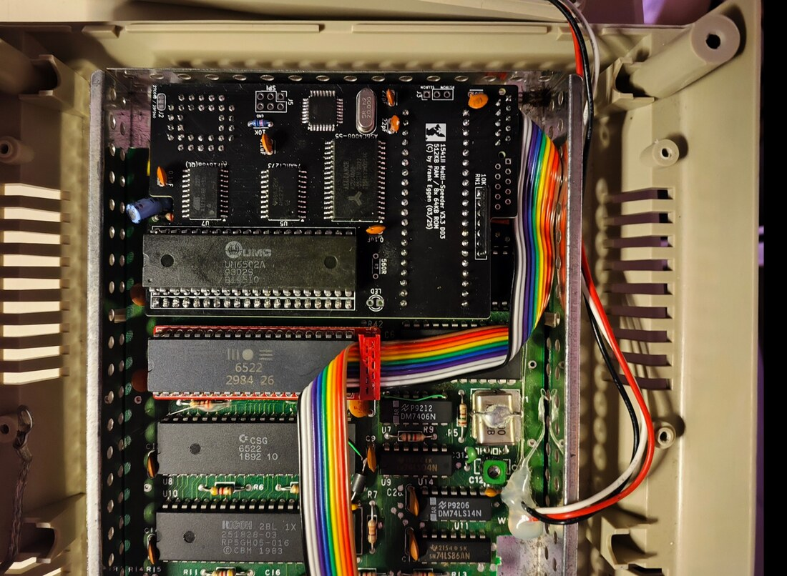
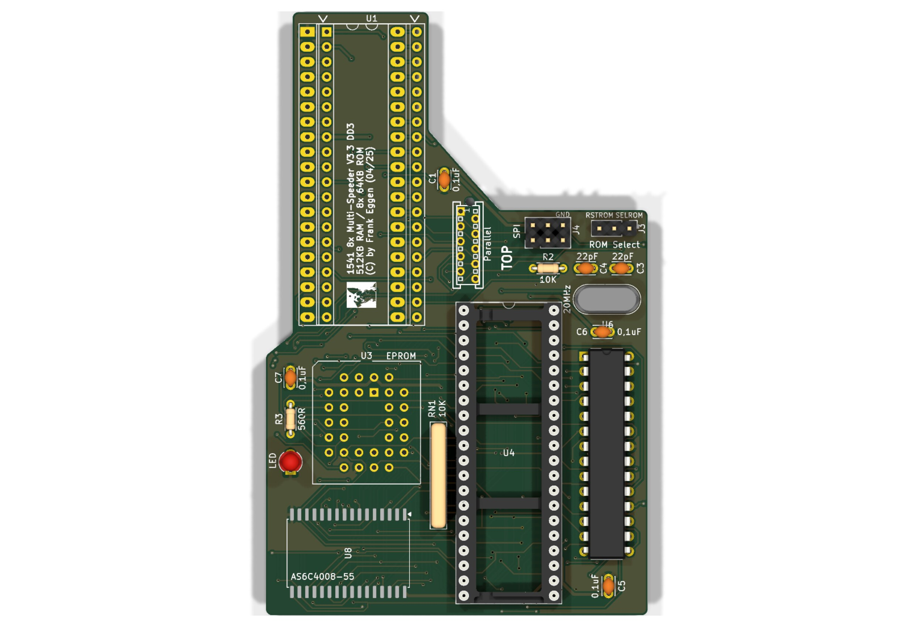
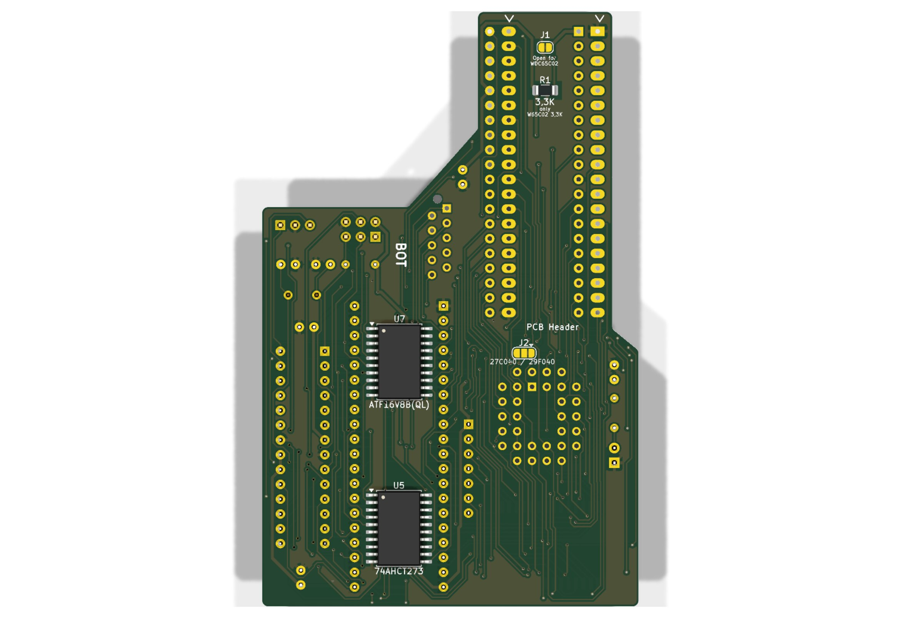
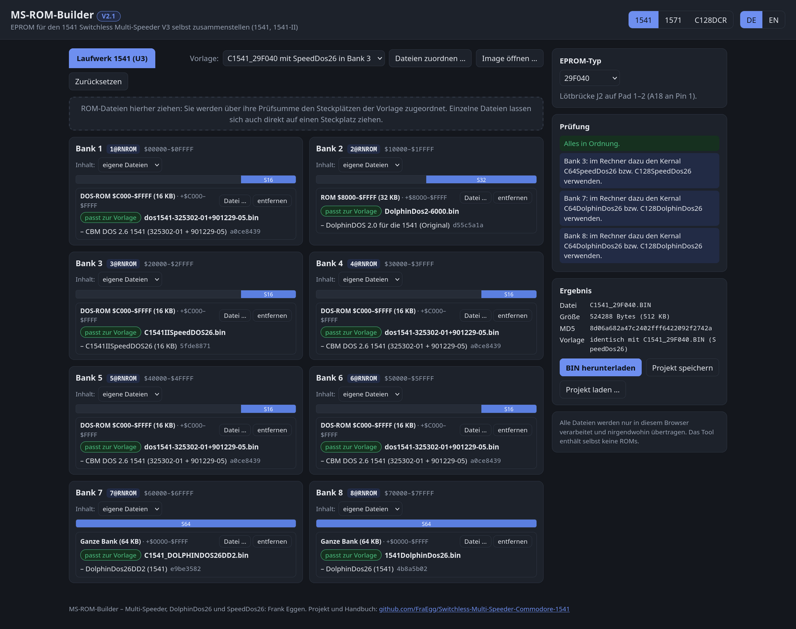
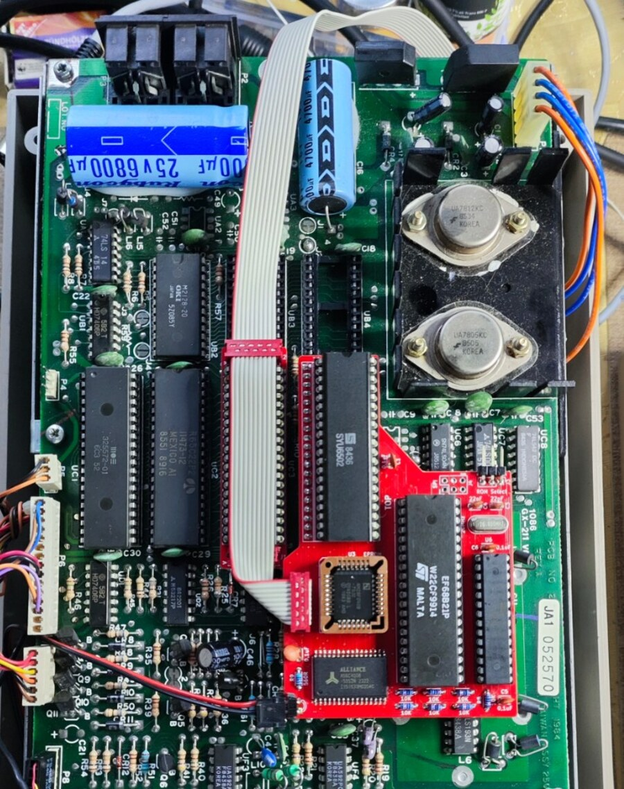
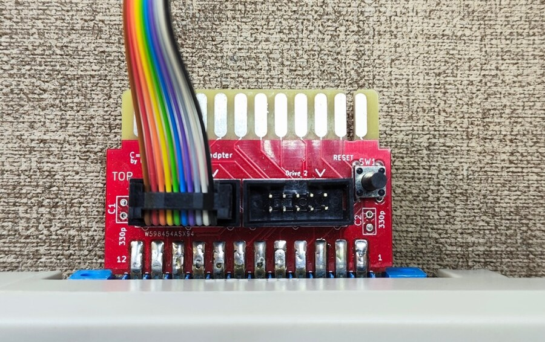

<p align="center"></p>

# Switchless 8x Multi-Floppy-Speeder V3 for the Commodore 1541

**512 KB flash EPROM and 512 KB RAM for the Commodore 1541 and 1541-II floppy drives, with parallel port and DolphinDos26.**

**Language:** [English](#english) · [Deutsch](#deutsch)

| | English | Deutsch |
|---|---|---|
| MS-ROM-Builder (browser tool for your own EPROM images) | [HTML](rom-builder/MS-ROM-Builder.html) | [HTML](rom-builder/MS-ROM-Builder.html) |
| 1541 Multi-Speeder V3 manual (hardware, parallel cable, C64 kernal, build instructions, BOM) | [PDF](manuals/en/MultiSpeeder1541_Manual.pdf) | [PDF](manuals/de/MultiSpeeder1541_Handbuch.pdf) |
| DolphinDos26 manual (operation, commands, MS-Tools) | [DolphinDOS26](https://github.com/FraEgg/DolphinDOS) | [DolphinDOS26](https://github.com/FraEgg/DolphinDOS) |
| Interactive bill of materials (open in a browser) | [HTML](hardware/bom/v3.3_1541_CPU_THT_DD3_Multi-Speeder_512KB_ibom.html) | [HTML](hardware/bom/v3.3_1541_CPU_THT_DD3_Multi-Speeder_512KB_ibom.html) |

**Related projects:**

| Project | Repository |
|---|---|
| Multi-Speeder project: entry page with the basics on the Multi-Speeder V3, DolphinDos26, SpeedDos26 and accessories | [github.com/FraEgg/Switchless-Multi-Speeder-Project](https://github.com/FraEgg/Switchless-Multi-Speeder-Project) |
| SpeedDos26: kernals for C64 and C128, firmware for 1541 and 1571, manual | [github.com/FraEgg/SpeedDOS](https://github.com/FraEgg/SpeedDOS) |
| DolphinDOS26: firmware, C64/C128 kernals, MS-Tools, manuals | [github.com/FraEgg/DolphinDOS](https://github.com/FraEgg/DolphinDOS) |
| Switchless 8x Multi-Floppy-Speeder for the external 1571 | [github.com/FraEgg/Switchless-Multi-Speeder-Commodore-1571](https://github.com/FraEgg/Switchless-Multi-Speeder-Commodore-1571) |
| Switchless 8x Multi-Floppy-Speeder for the C128DCR (internal 1571) | [github.com/FraEgg/Switchless-Multi-Speeder-Commodore-C128DCR-1571](https://github.com/FraEgg/Switchless-Multi-Speeder-Commodore-C128DCR-1571) |

<p align="center"></p>

---

# English

## What is this?

The **1541 Switchless 8x Multi-Floppy-Speeder V3** speeds up the **Commodore 1541** and **1541-II** floppy drives. It is a single board that sits in the CPU socket of the drive (1541: UC4, 1541-II: U3); the 6502 goes into the socket on the board. The parallel port is taken out of the drive with a cable to the user port of the C64 or C128. All parts are fitted inside the drive.

- **8 DOS banks** of 64 KB in a 512 KB flash EPROM **29F040**, switched by DOS command without a switch (`@I:n@RNROM`); the LED flashes n times
- **512 KB RAM** in the drive, mapped as 64 banks of 8 KB at `$6000`–`$7FFF`
- a **PIA 6821/W65C21** as an 8-bit parallel port and for selecting the RAM banks
- an extra ROM area `$2000`–`$3FFF` for DOS extensions (the MS-Addon of DolphinDos26)
- RAMBoard-compatible for nibbler programs (banks 1–4)

With **DolphinDos26** in the 1541 and a **DolphinDos26 kernal** in the computer, the drive gets parallel transfer, track cache, whole disks in the drive RAM (`CDR`/`CDW`), a RAM disk (`CDM`), the MS-Addon-API and the MS-Tools. The original Commodore DOS and other speeders stay available in the other banks.

## Which files do I need?

| File | Goes into | Content |
|---|---|---|
| [`C1541_29F040.BIN`](rom/C1541_29F040.BIN) | EPROM U3 of the Multi-Speeder board (29F040, 512 KB) | template: original Commodore DOS 2.6 (325302-01 + 901229-05) in banks 1 and 3–6, original DolphinDOS 2.0 in bank 2, DolphinDos26DD2 in bank 7, DolphinDos26 in bank 8 |
| [`1541DolphinDos26.bin`](rom/1541DolphinDos26.bin) | EPROM U3, bank 8 (offset `$70000`) | DolphinDos26 for the 1541 (64 KB, parallel cable on the PIA), for your own EPROM image |
| [`C1541_DOLPHINDOS26DD2.bin`](rom/C1541_DOLPHINDOS26DD2.bin) | EPROM U3, bank 7 (offset `$60000`) | DolphinDos26DD2 (64 KB, parallel cable on VIA1 like DolphinDOS 2.0/SpeedDOS) |
| [`C64DolphinDos26.bin`](rom/C64DolphinDos26.bin) | kernal socket of the C64 | C64 kernal DolphinDos26 (8 KB) |
| [`C64IIDolphinDos26.bin`](rom/C64IIDolphinDos26.bin) | combined BASIC/kernal ROM of the C64 II, or ROM 251913 of the C128 (C64 mode) | C64 BASIC and kernal DolphinDos26 (16 KB) |
| [`ms-tools.d64`](ms-tools/ms-tools.d64) | disk | MS-Tools for testing (`MS-MEMTEST`) and copying |
| [`hardware/gal`](hardware/gal) | GAL ATF16V8B (U7) | address decoder `ATF16V8_PAL_Adressendecoder_V3PIA_1541.jed` |
| [`hardware/atmega328p`](hardware/atmega328p) | ATmega328P (U6) | ROM switcher firmware (`.hex`), source (`.ino`), XGecu project (`.mpj`) |

The DolphinDos26 ROMs are the same as in the [DolphinDOS26](https://github.com/FraEgg/DolphinDOS) release. The C128 kernal C128DolphinDos26 for C128 mode is available there as well. `C1541_29F040.BIN` is a ready-made template for the EPROM of the Multi-Speeder board. Every bank maps the address space of the drive directly (bank start + `$C000` = CPU address `$C000`): the 16 KB Commodore DOS sits at bank start + `$C000`, DolphinDOS 2.0 at + `$A000`, the DolphinDos26 banks are complete 64 KB images; unused areas are `$FF`. Program it as it is, or replace single banks with other DOS versions.

| Command | EPROM offset | Bank content of `C1541_29F040.BIN` | Message of `@` |
|---|---|---|---|
| `1@RNROM` | `$00000` | Commodore DOS 2.6 | `73,CBM DOS V2.6 1541` |
| `2@RNROM` | `$10000` | DolphinDOS 2.0 (original, cable on VIA1) | `73,DOLPHINDOS.2 1541` |
| `3@RNROM` | `$20000` | Commodore DOS 2.6, free for further DOS versions | `73,CBM DOS V2.6 1541` |
| `4@RNROM` | `$30000` | Commodore DOS 2.6; recommended place for your own JiffyDOS ROM | `73,CBM DOS V2.6 1541` |
| `5@RNROM`, `6@RNROM` | `$40000`, `$50000` | Commodore DOS 2.6, free for further DOS versions | `73,CBM DOS V2.6 1541` |
| `7@RNROM` | `$60000` | **DolphinDos26DD2** (cable on VIA1) | `73,DOLPHINDOS26  DD2` |
| `8@RNROM` | `$70000` | **DolphinDos26** (cable on the PIA) | `73,DOLPHINDOS26 1541` |

**JiffyDOS:** JiffyDOS is not part of the project and is not contained in any template. If you own a licensed JiffyDOS ROM for the 1541, the best place for it is **bank 4** (`4@RNROM`): the 16 KB file goes to the end of the bank, from offset `$3C000` of the image. Banks 3, 5 and 6 are suitable as well. The easiest way is the MS-ROM-Builder (see below).

## Memory map of the drive

The address decoder maps different areas in banks 1–4 and banks 5–8. **DolphinDos26 and DolphinDos26DD2 need the PIA and therefore only run in banks 5–8.**

| Area | Banks 1–4 | Banks 5–8 |
|---|---|---|
| `$0000`–`$07FF` | 2 KB RAM of the 1541 | 2 KB RAM of the 1541 |
| `$1800`, `$1C00` | VIA 1 (serial bus), VIA 2 (drive control) | VIA 1, VIA 2 |
| `$2000`–`$3FFF` | EPROM of the active bank | EPROM: MS-Addon, API from `$3FFF` downwards |
| `$4000`–`$4FFF` | RAM (RAMBoard mode, same as `$6000`–`$6FFF`) | RAM: mirror of `$6000`–`$6FFF` |
| `$5000`–`$5FFF` | RAM (same as `$7000`–`$7FFF`) | `$5000`–`$5003` PIA 6821/W65C21: parallel port, RAM bank via PB0–PB5 |
| `$6000`–`$7FFF` | RAM: 8 KB window with a fixed RAM bank | 8 KB window into the 512 KB SRAM, 64 banks |
| `$8000`–`$9FFF` | RAM (same as `$6000`–`$7FFF`) | EPROM: DOS of the active bank |
| `$A000`–`$FFFF` | EPROM: DOS of the active bank | EPROM: DOS of the active bank |

Areas mapped after each command (every RAM area shows the same 8 KB window of the 512 KB SRAM, because the SRAM only gets the CPU address lines A0–A12):

| Command | Extra ROM | DOS ROM | RAM (one 8 KB window) | RAM bank | PIA |
|---|---|---|---|---|---|
| `1@RNROM` | `$2000`–`$3FFF` | `$A000`–`$FFFF` | `$4000`–`$9FFF` (three times) | fixed (bank 0) | – |
| `2@RNROM` | `$2000`–`$3FFF` | `$A000`–`$FFFF` | `$4000`–`$9FFF` (three times) | fixed (bank 0) | – |
| `3@RNROM` | `$2000`–`$3FFF` | `$A000`–`$FFFF` | `$4000`–`$9FFF` (three times) | fixed (bank 0) | – |
| `4@RNROM` | `$2000`–`$3FFF` | `$A000`–`$FFFF` | `$4000`–`$9FFF` (three times) | fixed (bank 0) | – |
| `5@RNROM` | `$2000`–`$3FFF` | `$8000`–`$FFFF` | `$4000`–`$4FFF`, `$6000`–`$7FFF` | 0–63 via PIA | `$5000`–`$5003` |
| `6@RNROM` | `$2000`–`$3FFF` | `$8000`–`$FFFF` | `$4000`–`$4FFF`, `$6000`–`$7FFF` | 0–63 via PIA | `$5000`–`$5003` |
| `7@RNROM` | `$2000`–`$3FFF` | `$8000`–`$FFFF` | `$4000`–`$4FFF`, `$6000`–`$7FFF` | 0–63 via PIA | `$5000`–`$5003` |
| `8@RNROM` | `$2000`–`$3FFF` | `$8000`–`$FFFF` | `$4000`–`$4FFF`, `$6000`–`$7FFF` | 0–63 via PIA | `$5000`–`$5003` |

## Hardware

| Folder | Content |
|---|---|
| [`hardware/gerber`](hardware/gerber) | Gerber files V3.3 (two layers, with PCBWay BOM and position file) |
| [`hardware/schematics`](hardware/schematics) | Schematic and board drawing V3.3 as PDF |
| [`hardware/bom`](hardware/bom) | Bill of materials V3.3 (CSV) and interactive BOM (`_ibom.html`) |
| [`hardware/gal`](hardware/gal) | JED file, circuit for the program Digital (`.dig`), memory map table and diagram of the address decoder |
| [`hardware/atmega328p`](hardware/atmega328p) | Firmware of the microcontroller |

<p align="center">


</p>

| Part | Value | Task |
|---|---|---|
| U1 | DIP40 socket | the 6502 of the 1541 |
| U2 | DIP40 header | plugs into the CPU socket of the 1541 |
| U3 | 29F040 (alternatives 27C040, SST39SF040), PLCC32 socket | 8 DOS banks of 64 KB |
| U4 | MC68B21 or W65C21 (PIA) | parallel port PA0–PA7, CA1, CA2; RAM bank PB0–PB5 |
| U5 | 74AHCT273 (SOIC-20) | bank latch A16–A18 |
| U6 | ATmega328P-PU, crystal Y1 20 MHz, C3/C4 22 pF | recognises `n@RNROM` and switches the bank |
| U7 | ATF16V8B(QL) (SOIC-20) | address decoder |
| U8 | AS6C4008-55 (SOP32) | 512 KB SRAM |
| D1, R3 | LED 3 mm, 560 Ω | flashes n times when switching to bank n |
| R2 | 10 kΩ | reset pull-up of the ATmega |
| RN1 | 10 kΩ SIP7 | pull-ups of the RAM address lines A13–A18 |
| C1, C5–C7 | 100 nF | decoupling |
| CN2 Parallel | Micro-MaTch, 10-way | parallel port to the user port of the computer |
| J3 ROM Select | 1×3 pin header | pin 1 SELROM, pin 2 GND, pin 3 RSTROM: briefly connecting pin 3 to GND resets to bank 1, pin 1 to GND advances one bank |
| J4 SPI | 2×3 pin header | ISP connector for programming the ATmega on the board |
| J1 | solder jumper, closed | open only for a WDC 65C02 (then fit R1 3.3 kΩ, SMD 1206) – DolphinDos26 needs the original NMOS 6502, J1 stays closed |
| J2 | solder jumper, three pads | EPROM type: 29F040 and SST39SF040 pad 1–2, 27C040 pad 2–3 |

ATmega328P fuse bytes: low `0xFF`, high `0xDE`, extended `0xFD`, lock bits `0xCF`. When programming with the XGecu project file, do not program the EEPROM. The complete bill of materials with DigiKey and Mouser links, the assembly order (SMD parts U5, U7, U8 first), the parallel cable pinout and the installation in the 1541 are in the [manual](manuals/en/MultiSpeeder1541_Manual.pdf), chapters 2, 8 and 9.

**Ordering the boards:** The boards can be made by any common PCB manufacturer from the Gerber files.

## MS-ROM-Builder (build your own EPROM images)

[`rom-builder/MS-ROM-Builder.html`](rom-builder/MS-ROM-Builder.html) is a browser tool for assembling the 512 KB EPROM image of the 1541 Multi-Speeder yourself. Download the file and open it in a current browser – no installation, works offline on Windows, macOS and Linux, and the ROM files never leave your computer. The tool contains no ROMs. It is one tool for all three Multi-Speeder boards (1541, external 1571, C128DCR); choose **1541** at the top right.

- All eight banks with the slots of the 1541: whole bank (64 KB), ROM `$8000`–`$FFFF` (32 KB), DOS ROM `$C000`–`$FFFF` (16 KB) or two single 8 KB ROMs. The template `C1541_29F040.BIN` is preset; a second preset holds SpeedDos26 in bank 3.
- Drop your ROM files in: they are assigned by their checksum, or placed directly onto a slot. Finished images can be opened, split into their parts and single banks replaced.
- Checks for missing, different or unknown ROMs, JiffyDOS content and reset vectors; warns when DolphinDos26 is placed in banks 1 to 4 (it needs the PIA, banks 5 to 8) and names the kernal that belongs to a bank. Shows solder jumper J2 for 29F040, SST39SF040 or 27C040.
- Download the finished 512 KB file with its MD5; save and load the layout as a small project file (no ROM data). German and English.

<p align="center"></p>

## Installation in short

1. Program the **29F040** for the Multi-Speeder board with the template `C1541_29F040.BIN` or with your own image (alternatives: 27C040 or SST39SF040). Set solder jumper **J2** for the EPROM type.
2. Program GAL and ATmega (do not program the ATmega EEPROM).
3. Open the 1541, take out the 6502 (1541: socket UC4, 1541-II: U3; socket it first if it is soldered in) and **remove the DOS ROMs** (1541: UB3 and UB4, 1541-II: U4) – the Multi-Speeder now supplies the DOS; a ROM left in place causes an address conflict.
4. Plug the Multi-Speeder board into the CPU socket, put the 6502 into socket U1 of the board.
5. Connect the parallel cable from CN2 to the user port of the computer (CN2 pin 1 CA2 → FLAG2, pins 2–9 PA0–PA7 → PB0–PB7, pin 10 CA1 ← PC2; manual chapter 2.4).
6. In the computer, fit a DolphinDos26 kernal: `C64DolphinDos26.bin` (C64), `C64IIDolphinDos26.bin` (C64 II, and C64 mode of the C128); the C128 kernal for C128 mode is in the [DolphinDOS26](https://github.com/FraEgg/DolphinDOS) release.
7. At the first start the drive reports `73,CBM DOS V2.6 1541` (bank 1). Switch with `OPEN 1,8,15,"I:8@RNROM":CLOSE 1`, the LED flashes eight times. `@` reports `73,DOLPHINDOS26 1541,00,00`, loading shows `LOADING DD:`.
8. Test the RAM with `MS-MEMTEST` from the MS-Tools disk.

<p align="center">


</p>

## Known limits

- DolphinDos26 and DolphinDos26DD2 only run in banks 5–8, because only there the decoder maps the PIA and the RAM window.
- DolphinDOS 2.0 (bank 2) and DolphinDos26DD2 (bank 7) expect the parallel cable on VIA1 of the 1541 (SpeedDOS cable), not on CN2; without that cable they work serially. With the cable on CN2, use bank 8.
- DolphinDos26 needs the original NMOS 6502, not a WDC 65C02.
- Before programs with their own fast loader that fail with DolphinDOS, enter `@X-` or switch to the Commodore DOS with `@I:1@RNROM`.

## What is in this repository?

```
manuals/en, de   1541 Multi-Speeder V3 manual as PDF
rom/             DolphinDos26 ROMs for the 1541 and the C64 (also C64 mode of the C128),
                 EPROM template C1541_29F040.BIN (drive)
ms-tools/        ms-tools.d64
rom-builder/     MS-ROM-Builder: browser tool for your own EPROM images
hardware/        Gerber, schematics, BOM, GAL and ATmega files (V3.3)
assets/          Images for this page
tools/           Maintenance scripts for this repository (make_eprom_1541.py, update_release.py)
CHECKSUMS.*      MD5 and SHA-256 of all published files
```

Apart from the template `C1541_29F040.BIN` (Commodore DOS 2.6, DolphinDOS 2.0, DolphinDos26DD2 and DolphinDos26), no EPROM image is included. JiffyDOS is commercial software and not part of this project; a licence is available from [RETRO Innovations](https://www.jiffydos.com). The C64 kernals contain JiffyDOS transfer routines – see [JiffyDOS licence: please check](#jiffydos-licence-please-check).

Verify your download with `sha256sum -c CHECKSUMS.sha256` or `md5sum -c CHECKSUMS.md5`.

## JiffyDOS licence: please check

The C64 kernals [`C64DolphinDos26.bin`](rom/C64DolphinDos26.bin) and [`C64IIDolphinDos26.bin`](rom/C64IIDolphinDos26.bin) contain JiffyDOS transfer routines that are instruction-identical to a JiffyDOS kernal (JiffyDOS sd2iec kernal); the same applies to the C128 kernals in the DolphinDOS26 project. The drive template `C1541_29F040.BIN` is free of JiffyDOS code; the JiffyDOS drive firmware is not included. Jim Brain of RETRO Innovations, which holds the JiffyDOS licence rights, confirmed that publishing the DolphinDos26 kernals on GitHub is fine. As he describes it, code that implements the same transfer behaviour without being an exact copy needs no licence. If the transfer code is the same, as it is here, he believes the end user would need one.

**Please check for yourself whether your use calls for an official JiffyDOS licence:** <https://www.jiffydos.com>

Details: [DolphinDOS26 – JiffyDOS licence](https://github.com/FraEgg/DolphinDOS#jiffydos-licence-please-check).

## Credits

| Who | What |
|---|---|
| Günther Jilg, Jan Bubela (Dolphin Software) | DolphinDOS 2.0 and 3.0, the base of DolphinDos26 |
| Per Bengtsson (RetroNynjah) | [Switchless Multi-ROM](https://github.com/RetroNynjah/Switchless-Multi-ROM-for-27128-27256), the ROM switcher sketch |
| Jim Drew, Joeri van Haren | Help and review of the hardware (V2.1) |
| silverdr | [Technical documentation on DolphinDOS 3](https://e4aws.silverdr.com/projects/dolphindos3/) |
| Stefan Kauf | Support with the idea of the Multi-Speeder |
| Mark Fellows / Creative Micro Designs; Jim Brain, RETRO Innovations | JiffyDOS |

**Special thanks to Jim Brain of RETRO Innovations** for his support with the JiffyDOS implementation of the DolphinDos26 kernals.

Multi-Speeder, DolphinDos26 and the manuals: **Frank Eggen**. If you would like to support the project: [donation via PayPal](https://www.paypal.com/donate/?cmd=_s-xclick&hosted_button_id=Q8HXKYARXKT4L&ssrt=1714757590172).

## Licence

Free for private, non-commercial use. No sale and no commercial use (boards, kits, ROM files, programmed EPROMs) without consulting the developer. Private hobby project without any warranty; building and installation at your own risk. Details: [LICENSE.md](LICENSE.md).

---

# Deutsch

## Was ist das?

Der **1541 Switchless 8x Multi-Floppy-Speeder V3** beschleunigt die Diskettenlaufwerke **Commodore 1541** und **1541-II**. Er besteht aus einer Platine, die im CPU-Sockel des Laufwerks sitzt (1541: UC4, 1541-II: U3); die 6502 kommt in den Sockel auf der Platine. Der Parallelport wird mit einem Kabel aus dem Laufwerk zum Userport des C64 oder C128 geführt. Alle Teile sind im Laufwerk verbaut.

- **8 DOS-Bänke** zu 64 KB in einem 512-KB-Flash-EPROM **29F040**, umgeschaltet per DOS-Befehl ohne Schalter (`@I:n@RNROM`); die Leuchtdiode blinkt n-mal
- **512 KB RAM** im Laufwerk, eingeblendet als 64 Bänke zu 8 KB bei `$6000`–`$7FFF`
- ein **PIA 6821/W65C21** als 8-Bit-Parallelport und zur Wahl der RAM-Bank
- ein zusätzlicher ROM-Bereich `$2000`–`$3FFF` für DOS-Erweiterungen (das MS-Addon von DolphinDos26)
- RAMBoard-kompatibel für Nibbler-Programme (Bänke 1–4)

Mit **DolphinDos26** in der 1541 und einem **DolphinDos26-Kernal** im Rechner bietet das Laufwerk Parallelübertragung, Track-Cache, ganze Disketten im Laufwerks-RAM (`CDR`/`CDW`), eine RAM-Disk (`CDM`), die MS-Addon-API und die MS-Tools. Das originale Commodore-DOS und andere Speeder bleiben in den übrigen Bänken erreichbar.

## Welche Dateien brauche ich?

| Datei | Kommt in | Inhalt |
|---|---|---|
| [`C1541_29F040.BIN`](rom/C1541_29F040.BIN) | EPROM U3 der Multi-Speeder-Platine (29F040, 512 KB) | Vorlage: originales Commodore-DOS 2.6 (325302-01 + 901229-05) in den Bänken 1 und 3–6, originales DolphinDOS 2.0 in Bank 2, DolphinDos26DD2 in Bank 7, DolphinDos26 in Bank 8 |
| [`1541DolphinDos26.bin`](rom/1541DolphinDos26.bin) | EPROM U3, Bank 8 (Offset `$70000`) | DolphinDos26 für die 1541 (64 KB, Parallelkabel am PIA), für ein eigenes EPROM-Abbild |
| [`C1541_DOLPHINDOS26DD2.bin`](rom/C1541_DOLPHINDOS26DD2.bin) | EPROM U3, Bank 7 (Offset `$60000`) | DolphinDos26DD2 (64 KB, Parallelkabel am VIA1 wie bei DolphinDOS 2.0/SpeedDOS) |
| [`C64DolphinDos26.bin`](rom/C64DolphinDos26.bin) | Kernal-Sockel des C64 | C64-Kernal DolphinDos26 (8 KB) |
| [`C64IIDolphinDos26.bin`](rom/C64IIDolphinDos26.bin) | kombiniertes BASIC-/Kernal-ROM des C64 II oder ROM 251913 des C128 (C64-Modus) | C64-BASIC und -Kernal DolphinDos26 (16 KB) |
| [`ms-tools.d64`](ms-tools/ms-tools.d64) | Diskette | MS-Tools zum Testen (`MS-MEMTEST`) und Kopieren |
| [`hardware/gal`](hardware/gal) | GAL ATF16V8B (U7) | Adressdecoder `ATF16V8_PAL_Adressendecoder_V3PIA_1541.jed` |
| [`hardware/atmega328p`](hardware/atmega328p) | ATmega328P (U6) | Firmware des ROM-Umschalters (`.hex`), Quelltext (`.ino`), XGecu-Projekt (`.mpj`) |

Die DolphinDos26-ROMs sind dieselben wie im Release von [DolphinDOS26](https://github.com/FraEgg/DolphinDOS). Dort gibt es auch den C128-Kernal C128DolphinDos26 für den C128-Modus. `C1541_29F040.BIN` ist eine fertige Vorlage für das EPROM der Multi-Speeder-Platine. Jede Bank bildet den Adressraum des Laufwerks direkt ab (Bankanfang + `$C000` = CPU-Adresse `$C000`): Das 16 KB große Commodore-DOS liegt bei Bankanfang + `$C000`, DolphinDOS 2.0 bei + `$A000`, die DolphinDos26-Bänke sind vollständige 64-KB-Abbilder; ungenutzte Bereiche sind `$FF`. Sie kann direkt gebrannt werden, einzelne Bänke lassen sich durch andere DOS-Versionen ersetzen.

| Befehl | EPROM-Offset | Bankinhalt von `C1541_29F040.BIN` | Meldung von `@` |
|---|---|---|---|
| `1@RNROM` | `$00000` | Commodore-DOS 2.6 | `73,CBM DOS V2.6 1541` |
| `2@RNROM` | `$10000` | DolphinDOS 2.0 (Original, Kabel am VIA1) | `73,DOLPHINDOS.2 1541` |
| `3@RNROM` | `$20000` | Commodore-DOS 2.6, frei für weitere DOS-Versionen | `73,CBM DOS V2.6 1541` |
| `4@RNROM` | `$30000` | Commodore-DOS 2.6; Empfehlung: Platz für ein eigenes JiffyDOS-ROM | `73,CBM DOS V2.6 1541` |
| `5@RNROM`, `6@RNROM` | `$40000`, `$50000` | Commodore-DOS 2.6, frei für weitere DOS-Versionen | `73,CBM DOS V2.6 1541` |
| `7@RNROM` | `$60000` | **DolphinDos26DD2** (Kabel am VIA1) | `73,DOLPHINDOS26  DD2` |
| `8@RNROM` | `$70000` | **DolphinDos26** (Kabel am PIA) | `73,DOLPHINDOS26 1541` |

**JiffyDOS:** JiffyDOS gehört nicht zum Projekt und ist in keiner Vorlage enthalten. Wer ein eigenes, lizenziertes JiffyDOS-ROM für die 1541 besitzt, legt es am besten in **Bank 4** (`4@RNROM`): die 16-KB-Datei kommt an das Ende der Bank, ab Offset `$3C000` des Abbilds. Die Bänke 3, 5 und 6 eignen sich ebenso. Am einfachsten geht das mit dem MS-ROM-Builder (siehe unten).

## Speicherbelegung des Laufwerks

Der Adressdecoder blendet in den Bänken 1–4 und 5–8 unterschiedliche Bereiche ein. **DolphinDos26 und DolphinDos26DD2 brauchen den PIA und laufen deshalb nur in den Bänken 5–8.**

| Bereich | Bänke 1–4 | Bänke 5–8 |
|---|---|---|
| `$0000`–`$07FF` | 2 KB RAM der 1541 | 2 KB RAM der 1541 |
| `$1800`, `$1C00` | VIA 1 (serieller Bus), VIA 2 (Laufwerkssteuerung) | VIA 1, VIA 2 |
| `$2000`–`$3FFF` | EPROM der aktiven Bank | EPROM: MS-Addon, API ab `$3FFF` abwärts |
| `$4000`–`$4FFF` | RAM (RAMBoard-Modus, wie `$6000`–`$6FFF`) | RAM: Spiegel von `$6000`–`$6FFF` |
| `$5000`–`$5FFF` | RAM (wie `$7000`–`$7FFF`) | `$5000`–`$5003` PIA 6821/W65C21: Parallelport, RAM-Bank über PB0–PB5 |
| `$6000`–`$7FFF` | RAM: 8-KB-Fenster mit fester RAM-Bank | 8-KB-Fenster ins 512-KB-SRAM, 64 Bänke |
| `$8000`–`$9FFF` | RAM (wie `$6000`–`$7FFF`) | EPROM: DOS der aktiven Bank |
| `$A000`–`$FFFF` | EPROM: DOS der aktiven Bank | EPROM: DOS der aktiven Bank |

Eingeblendete Bereiche nach jedem Befehl (jeder RAM-Bereich zeigt dasselbe 8-KB-Fenster des 512-KB-SRAM, weil das SRAM nur die CPU-Adressleitungen A0–A12 bekommt):

| Befehl | Zusatz-ROM | DOS-ROM | RAM (ein 8-KB-Fenster) | RAM-Bank | PIA |
|---|---|---|---|---|---|
| `1@RNROM` | `$2000`–`$3FFF` | `$A000`–`$FFFF` | `$4000`–`$9FFF` (dreifach) | fest (Bank 0) | – |
| `2@RNROM` | `$2000`–`$3FFF` | `$A000`–`$FFFF` | `$4000`–`$9FFF` (dreifach) | fest (Bank 0) | – |
| `3@RNROM` | `$2000`–`$3FFF` | `$A000`–`$FFFF` | `$4000`–`$9FFF` (dreifach) | fest (Bank 0) | – |
| `4@RNROM` | `$2000`–`$3FFF` | `$A000`–`$FFFF` | `$4000`–`$9FFF` (dreifach) | fest (Bank 0) | – |
| `5@RNROM` | `$2000`–`$3FFF` | `$8000`–`$FFFF` | `$4000`–`$4FFF`, `$6000`–`$7FFF` | 0–63 über PIA | `$5000`–`$5003` |
| `6@RNROM` | `$2000`–`$3FFF` | `$8000`–`$FFFF` | `$4000`–`$4FFF`, `$6000`–`$7FFF` | 0–63 über PIA | `$5000`–`$5003` |
| `7@RNROM` | `$2000`–`$3FFF` | `$8000`–`$FFFF` | `$4000`–`$4FFF`, `$6000`–`$7FFF` | 0–63 über PIA | `$5000`–`$5003` |
| `8@RNROM` | `$2000`–`$3FFF` | `$8000`–`$FFFF` | `$4000`–`$4FFF`, `$6000`–`$7FFF` | 0–63 über PIA | `$5000`–`$5003` |

## Hardware

| Ordner | Inhalt |
|---|---|
| [`hardware/gerber`](hardware/gerber) | Gerber-Dateien V3.3 (zwei Lagen, mit Stückliste und Bestückungsdatei für PCBWay) |
| [`hardware/schematics`](hardware/schematics) | Schaltplan und Platinenzeichnung V3.3 als PDF |
| [`hardware/bom`](hardware/bom) | Stückliste V3.3 (CSV) und interaktive Stückliste (`_ibom.html`) |
| [`hardware/gal`](hardware/gal) | JED-Datei, Schaltung für das Programm Digital (`.dig`), Tabelle der Speicheraufteilung und Diagramm des Adressdecoders |
| [`hardware/atmega328p`](hardware/atmega328p) | Firmware des Mikrocontrollers |

| Bauteil | Wert | Aufgabe |
|---|---|---|
| U1 | DIP40-Sockel | die 6502 der 1541 |
| U2 | DIP40-Stecker | steckt im CPU-Sockel der 1541 |
| U3 | 29F040 (alternativ 27C040, SST39SF040), PLCC32-Sockel | 8 DOS-Bänke zu 64 KB |
| U4 | MC68B21 oder W65C21 (PIA) | Parallelport PA0–PA7, CA1, CA2; RAM-Bank PB0–PB5 |
| U5 | 74AHCT273 (SOIC-20) | Bank-Latch A16–A18 |
| U6 | ATmega328P-PU, Quarz Y1 20 MHz, C3/C4 22 pF | erkennt `n@RNROM` und schaltet die Bank |
| U7 | ATF16V8B(QL) (SOIC-20) | Adressdecoder |
| U8 | AS6C4008-55 (SOP32) | 512-KB-SRAM |
| D1, R3 | Leuchtdiode 3 mm, 560 Ω | blinkt beim Umschalten auf Bank n n-mal |
| R2 | 10 kΩ | Reset-Pull-up des ATmega |
| RN1 | 10 kΩ SIP7 | Pull-ups der RAM-Adressleitungen A13–A18 |
| C1, C5–C7 | 100 nF | Abblockkondensatoren |
| CN2 Parallel | Micro-MaTch, 10-polig | Parallelport zum Userport des Rechners |
| J3 ROM Select | Stiftleiste 1×3 | Pin 1 SELROM, Pin 2 GND, Pin 3 RSTROM: Pin 3 kurz an GND setzt auf Bank 1 zurück, Pin 1 an GND schaltet eine Bank weiter |
| J4 SPI | Stiftleiste 2×3 | ISP-Anschluss zum Programmieren des ATmega auf der Platine |
| J1 | Lötbrücke, geschlossen | nur für eine WDC 65C02 öffnen (dann R1 3,3 kΩ, SMD 1206, bestücken) – DolphinDos26 braucht die originale NMOS-6502, J1 bleibt geschlossen |
| J2 | Lötbrücke, drei Pads | EPROM-Typ: 29F040 und SST39SF040 Pad 1–2, 27C040 Pad 2–3 |

Fuse-Bytes des ATmega328P: Low `0xFF`, High `0xDE`, Extended `0xFD`, Lock-Bits `0xCF`. Beim Programmieren mit der XGecu-Projektdatei das EEPROM nicht mitprogrammieren. Die vollständige Stückliste mit DigiKey- und Mouser-Links, die Bestückungsreihenfolge (zuerst die SMD-Teile U5, U7, U8), die Belegung des Parallelkabels und der Einbau in die 1541 stehen im [Handbuch](manuals/de/MultiSpeeder1541_Handbuch.pdf), Kapitel 2, 8 und 9.

**Platinen bestellen:** Die Platinen lassen sich aus den Gerber-Dateien bei jedem üblichen Leiterplattenhersteller fertigen.

## MS-ROM-Builder (EPROM-Abbilder selbst bauen)

[`rom-builder/MS-ROM-Builder.html`](rom-builder/MS-ROM-Builder.html) ist ein Browser-Tool, mit dem sich das 512-KB-EPROM-Abbild des 1541 Multi-Speeders selbst zusammenstellen lässt. Die Datei herunterladen und in einem aktuellen Browser öffnen – ohne Installation, offline unter Windows, macOS und Linux, und die ROM-Dateien verlassen den Rechner nicht. Das Tool enthält keine ROMs. Es ist ein Tool für alle drei Multi-Speeder-Platinen (1541, externe 1571, C128DCR); oben rechts **1541** wählen.

- Alle acht Bänke mit den Steckplätzen der 1541: ganze Bank (64 KB), ROM `$8000`–`$FFFF` (32 KB), DOS-ROM `$C000`–`$FFFF` (16 KB) oder zwei einzelne 8-KB-ROMs. Die Vorlage `C1541_29F040.BIN` ist voreingestellt; eine zweite Voreinstellung enthält SpeedDos26 in Bank 3.
- ROM-Dateien hineinziehen: Sie werden über ihre Prüfsumme zugeordnet oder direkt auf einen Steckplatz gelegt. Fertige Abbilder lassen sich öffnen, in ihre Teile zerlegen und einzelne Bänke tauschen.
- Prüfung auf fehlende, abweichende oder unbekannte ROMs, JiffyDOS-Inhalt und Reset-Vektoren; warnt, wenn DolphinDos26 in Bank 1 bis 4 liegt (es braucht den PIA, Bank 5 bis 8), und nennt den Kernal, der zu einer Bank gehört. Zeigt die Lötbrücke J2 für 29F040, SST39SF040 oder 27C040.
- Die fertige 512-KB-Datei mit MD5 herunterladen; die Belegung als kleine Projektdatei speichern und laden (ohne ROM-Daten). Deutsch und Englisch.

<p align="center"></p>

## Einbau in Kürze

1. Den **29F040** der Multi-Speeder-Platine mit der Vorlage `C1541_29F040.BIN` oder mit einem eigenen Abbild brennen (alternativ 27C040 oder SST39SF040). Die Lötbrücke **J2** passend zum EPROM-Typ setzen.
2. GAL und ATmega programmieren (das EEPROM des ATmega nicht mitprogrammieren).
3. Die 1541 öffnen, die 6502 herausnehmen (1541: Sockel UC4, 1541-II: U3; ist sie eingelötet, vorher einen Sockel einsetzen) und **die DOS-ROMs entfernen** (1541: UB3 und UB4, 1541-II: U4) – der Multi-Speeder liefert jetzt das DOS; ein verbliebenes ROM führt zu einem Adresskonflikt.
4. Die Multi-Speeder-Platine in den CPU-Sockel stecken, die 6502 in den Sockel U1 der Platine setzen.
5. Das Parallelkabel von CN2 zum Userport des Rechners verbinden (CN2 Pin 1 CA2 → FLAG2, Pin 2–9 PA0–PA7 → PB0–PB7, Pin 10 CA1 ← PC2; Handbuch Kapitel 2.4).
6. Im Rechner einen DolphinDos26-Kernal einsetzen: `C64DolphinDos26.bin` (C64), `C64IIDolphinDos26.bin` (C64 II und C64-Modus des C128); den C128-Kernal für den C128-Modus gibt es im Release von [DolphinDOS26](https://github.com/FraEgg/DolphinDOS).
7. Beim ersten Start meldet sich das Laufwerk mit `73,CBM DOS V2.6 1541` (Bank 1). Mit `OPEN 1,8,15,"I:8@RNROM":CLOSE 1` umschalten, die Leuchtdiode blinkt achtmal. `@` meldet `73,DOLPHINDOS26 1541,00,00`, beim Laden erscheint `LOADING DD:`.
8. Das RAM mit `MS-MEMTEST` von der MS-Tools-Diskette prüfen.

## Bekannte Grenzen

- DolphinDos26 und DolphinDos26DD2 laufen nur in den Bänken 5–8, weil nur dort der Decoder den PIA und das RAM-Fenster einblendet.
- DolphinDOS 2.0 (Bank 2) und DolphinDos26DD2 (Bank 7) erwarten das Parallelkabel am VIA1 der 1541 (SpeedDOS-Kabel), nicht an CN2; ohne dieses Kabel arbeiten sie seriell. Mit dem Kabel an CN2 ist Bank 8 die richtige Wahl.
- DolphinDos26 braucht die originale NMOS-6502, keine WDC 65C02.
- Versagt ein Programm mit eigenem Schnelllader unter DolphinDOS, vorher `@X-` eingeben oder mit `@I:1@RNROM` auf das Commodore-DOS wechseln.

## Was liegt in diesem Repository?

```
manuals/en, de   Handbuch 1541 Multi-Speeder V3 als PDF
rom/             DolphinDos26-ROMs für die 1541 und den C64 (auch C64-Modus des C128),
                 EPROM-Vorlage C1541_29F040.BIN (Laufwerk)
ms-tools/        ms-tools.d64
rom-builder/     MS-ROM-Builder: Browser-Tool für eigene EPROM-Abbilder
hardware/        Gerber, Schaltpläne, Stückliste, GAL- und ATmega-Dateien (V3.3)
assets/          Bilder für diese Seite
tools/           Pflegeskripte für dieses Repository (make_eprom_1541.py, update_release.py)
CHECKSUMS.*      MD5 und SHA-256 aller veröffentlichten Dateien
```

Außer der Vorlage `C1541_29F040.BIN` (Commodore-DOS 2.6, DolphinDOS 2.0, DolphinDos26DD2 und DolphinDos26) ist kein EPROM-Abbild enthalten. JiffyDOS ist kommerzielle Software und nicht Teil des Projekts; eine Lizenz gibt es bei [RETRO Innovations](https://www.jiffydos.com). Die C64-Kernals enthalten JiffyDOS-Übertragungsroutinen – siehe [JiffyDOS-Lizenz: bitte prüfen](#jiffydos-lizenz-bitte-pr%C3%BCfen).

Den Download prüfen mit `sha256sum -c CHECKSUMS.sha256` oder `md5sum -c CHECKSUMS.md5`.

## JiffyDOS-Lizenz: bitte prüfen

Die C64-Kernals [`C64DolphinDos26.bin`](rom/C64DolphinDos26.bin) und [`C64IIDolphinDos26.bin`](rom/C64IIDolphinDos26.bin) enthalten JiffyDOS-Übertragungsroutinen, die befehlsgleich aus einem JiffyDOS-Kernal stammen (JiffyDOS-sd2iec-Kernal); dasselbe gilt für die C128-Kernals im Projekt DolphinDOS26. Die Laufwerks-Vorlage `C1541_29F040.BIN` enthält keinen JiffyDOS-Code; die JiffyDOS-Firmware für das Laufwerk ist nicht enthalten. Jim Brain von RETRO Innovations, das die JiffyDOS-Lizenzrechte hält, hat die Veröffentlichung der DolphinDos26-Kernals auf GitHub erlaubt. Nach seiner Beschreibung ist für Code, der dasselbe Übertragungsverhalten umsetzt, aber keine genaue Kopie ist, keine Lizenz nötig. Ist der Übertragungscode gleich, wie hier, wäre nach seiner Einschätzung beim Endnutzer eine Lizenz erforderlich.

**Bitte prüfe selbst, ob du wegen der Nutzung eine offizielle JiffyDOS-Lizenz erwerben solltest:** <https://www.jiffydos.com>

Einzelheiten: [DolphinDOS26 – JiffyDOS-Lizenz](https://github.com/FraEgg/DolphinDOS#jiffydos-lizenz-bitte-pr%C3%BCfen).

## Danksagung

| Wer | Was |
|---|---|
| Günther Jilg, Jan Bubela (Dolphin Software) | DolphinDOS 2.0 und 3.0, die Grundlage von DolphinDos26 |
| Per Bengtsson (RetroNynjah) | [Switchless Multi-ROM](https://github.com/RetroNynjah/Switchless-Multi-ROM-for-27128-27256), der Sketch des ROM-Umschalters |
| Jim Drew, Joeri van Haren | Hilfe und Review der Hardware (V2.1) |
| silverdr | [Technische Dokumentation zu DolphinDOS 3](https://e4aws.silverdr.com/projects/dolphindos3/) |
| Stefan Kauf | Unterstützung bei der Idee des Multi-Speeders |
| Mark Fellows / Creative Micro Designs; Jim Brain, RETRO Innovations | JiffyDOS |

**Besonderer Dank gilt Jim Brain von RETRO Innovations** für seine Unterstützung bei der JiffyDOS-Implementierung der DolphinDos26-Kernals.

Multi-Speeder, DolphinDos26 und die Handbücher: **Frank Eggen**. Wer das Projekt unterstützen möchte: [Spende per PayPal](https://www.paypal.com/donate/?cmd=_s-xclick&hosted_button_id=Q8HXKYARXKT4L&ssrt=1714757590172).

## Lizenz

Frei für den privaten, nicht kommerziellen Gebrauch. Kein Verkauf und keine kommerzielle Nutzung (Platinen, Bausätze, ROM-Dateien, gebrannte EPROMs) ohne Rücksprache mit dem Entwickler. Privates Hobbyprojekt ohne jede Gewährleistung; Nachbau und Einbau auf eigene Gefahr. Details: [LICENSE.md](LICENSE.md).
